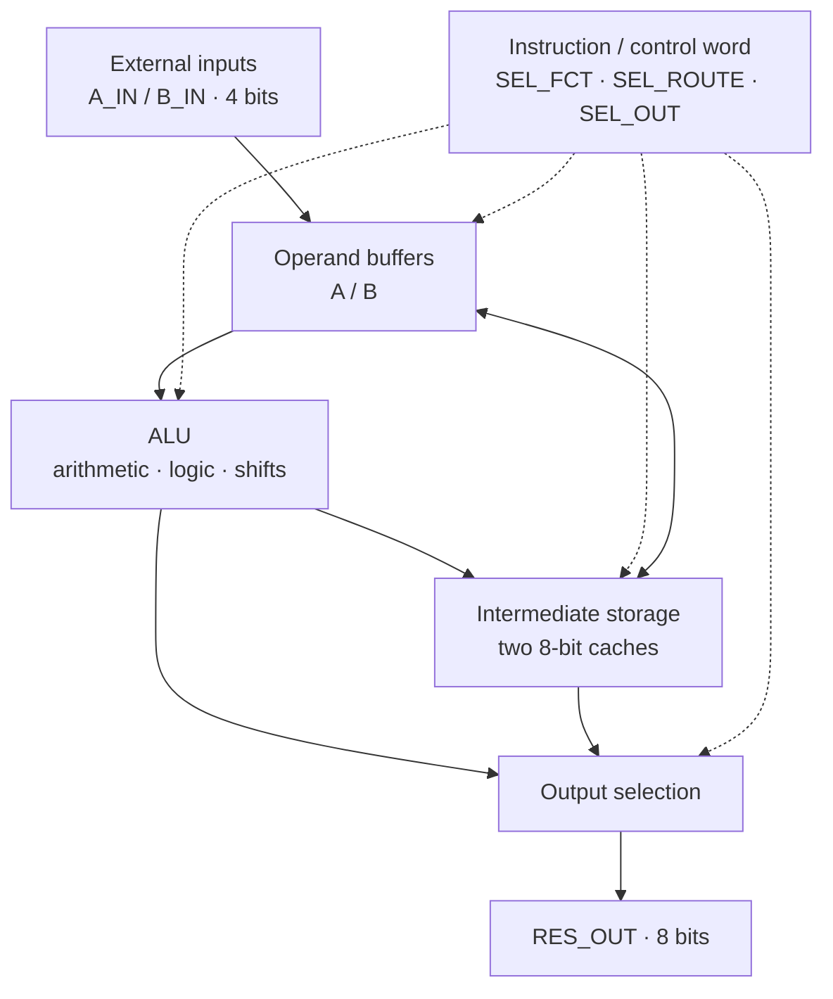

# vhdl-core

A small **processor core designed in VHDL**, built to explore how an arithmetic and logic unit (ALU), a datapath, registers, and instruction-driven control work together at the RTL level.

This is an educational digital-design project, not an implementation of an existing commercial instruction set or a general-purpose CPU.

## Background

The project originated in **TE608 — Conception de systèmes numériques en VHDL 2** at Efrei (2025–2026), as part of the *LogiGame* assignment. The course proposed designing and testing a simple processor core on a **Digilent Arty board (Xilinx Artix-7 FPGA)**, then using it to compute a pseudo-random sequence for an interactive reflex game.

This repository is focused on the **processor core and its simulation testbenches**. The wider game, its timer, buttons, LEDs, and score logic are part of the course context and should not be confused with the contents of this repository.

## Architecture

The reference architecture uses **4-bit signed operands** and **8-bit results and intermediate storage**. Its main building blocks are:

- **ALU:** arithmetic, bitwise logic, and shifts selected by a 4-bit function code.
- **Operand buffers:** registers holding the 4-bit values supplied to the ALU.
- **Intermediate storage:** two 8-bit caches used to retain values between operations.
- **Data routing:** a selector that moves input data, ALU results, or cached values into the appropriate registers.
- **Instruction control:** an instruction word that selects the ALU function, data movement, and output source.

At a high level, the datapath can be understood as:



### Control word

The course-defined instruction format is **10 bits** wide:

| Field | Width | Purpose |
| --- | ---: | --- |
| `SEL_FCT` | 4 bits | Selects an ALU operation |
| `SEL_ROUTE` | 4 bits | Selects a register/cache transfer |
| `SEL_OUT` | 2 bits | Selects the value exposed at `RES_OUT` |

The reference design specifies a **128 × 10-bit instruction memory** to sequence these control words. This is a small, application-oriented control architecture rather than a general-purpose ISA with branches, a stack, or an operating system.

### ALU operations

The TE608 specification defines the following 4-bit function encoding:

| `SEL_FCT` | Operation |
| :---: | --- |
| `0000` | No operation / zero result |
| `0001` / `0010` | `A` / `NOT A` |
| `0011` / `0100` | `B` / `NOT B` |
| `0101` / `0110` / `0111` | `A AND B` / `A OR B` / `A XOR B` |
| `1000` / `1001` | Addition with / without input carry |
| `1010` | `A - B` |
| `1011` | `A * B` |
| `1100` / `1101` | Shift `A` right / left, using the serial input |
| `1110` / `1111` | Shift `B` right / left, using the serial input |

Shift operations use serial input/output signals (`SR_IN_L`, `SR_IN_R`, `SR_OUT_L`, `SR_OUT_R`) to exchange bits at the boundaries. The routing and cache registers make it possible to build multi-step computations from these simple ALU operations.

> **Note:** The encodings and memory dimensions above describe the **course's reference architecture**. Consult the RTL in `src/` for the exact behavior and feature coverage of this implementation.

## Repository structure

```text
vhdl-core/
├── src/             # VHDL design sources
├── testbenchs/      # Simulation testbenches (repository spelling)
├── Makefile         # GHDL build and simulation targets
└── .gitignore
```

The Makefile builds the RTL together with **one selected testbench**. Its default testbench is `tb_processor.vhd`.

## Simulating the design

### Requirements

- [GHDL](https://github.com/ghdl/ghdl) — VHDL simulator, with VHDL-2008 support
- `make`
- Optional: [GTKWave](https://gtkwave.sourceforge.net/) to inspect waveforms

### Run the default testbench

```sh
git clone https://github.com/gregoire-badiche/vhdl-core.git
cd vhdl-core
make
```

The Makefile analyzes the sources, elaborates `tb_processor`, and runs the simulation for up to **2 ms**. A VCD waveform is written to:

```text
sim/tb_processor.vcd
```

Open it with GTKWave:

```sh
gtkwave sim/tb_processor.vcd
```

To run a different testbench, specify its **filename** (from `testbenchs/`):

```sh
make clean
make tb=<testbench_filename>.vhd
```

Additional targets:

```sh
make analyze     # Analyze VHDL sources and selected testbench
make elaborate   # Elaborate the selected testbench
make sim         # Run simulation and generate a VCD file
make clean       # Remove generated build/ and sim/ directories
```

The current Makefile uses GHDL's `--std=08` and `-fsynopsys` flags. Its simulation stop time is fixed at `2ms`; adjust the Makefile if a testbench needs a longer run.

## What this project explores

The interesting part of this exercise is not processor performance; it is making the interaction between **combinational logic, sequential state, and control signals** explicit:

- Encoding arithmetic and logical operations in an ALU.
- Handling operand width, sign representation, and intermediate results.
- Moving data between operand registers and wider caches.
- Sequencing operations using compact control words.
- Testing RTL behavior with simulation and inspecting waveform traces.

The broader TE608 assignment also considered computing a **4-bit LFSR** (feedback polynomial *x⁴ + x³ + 1*) through successive ALU operations, illustrating how a fixed datapath can perform a more complex algorithm by changing its instruction sequence.

## Scope and limitations

- **Educational RTL:** intended for learning about digital systems and processor/datapath design, not production use.
- **Course-specific control model:** not a standard processor ISA, and not meant to run arbitrary compiled programs.
- **Simulation first:** the repository provides a GHDL workflow; the assignment's Arty/Artix-7 board is the original hardware target, not a claim that this repository contains a reproducible Vivado implementation.
- **Implementation details:** for precise functional behavior, the VHDL sources and testbenches are the reference; the architecture and instruction table above reproduce the original course design goals.

## Credits

Developed as part of Efrei's **TE608 — Conception de systèmes numériques en VHDL 2** (2025–2026), taught by **Didier Meier**.
